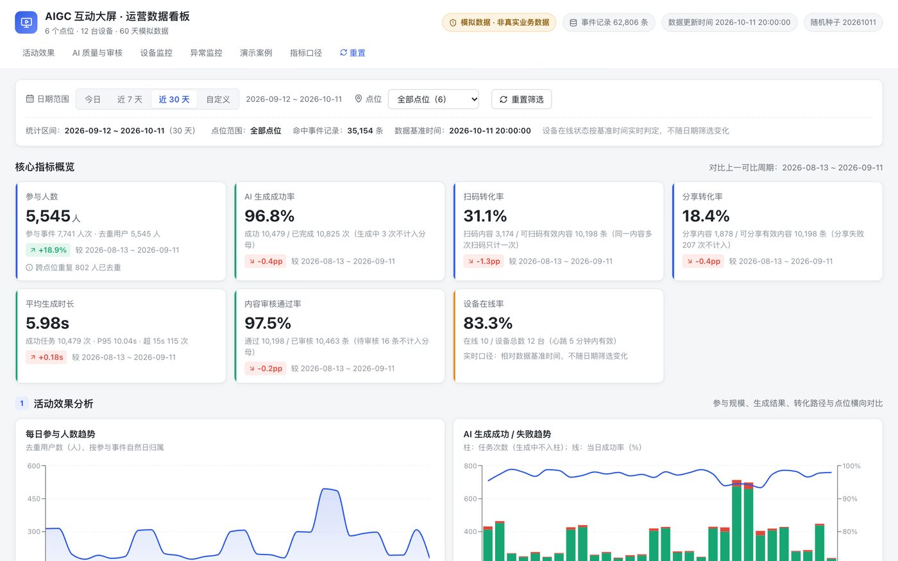
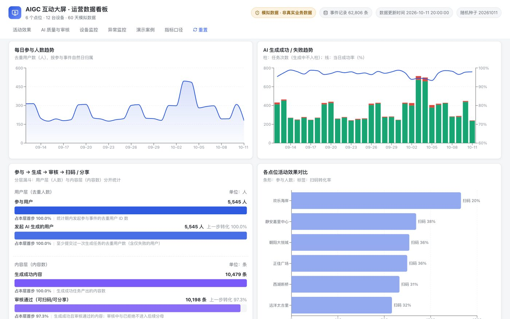
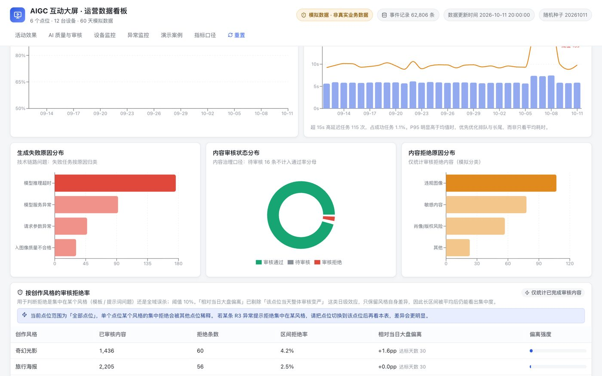
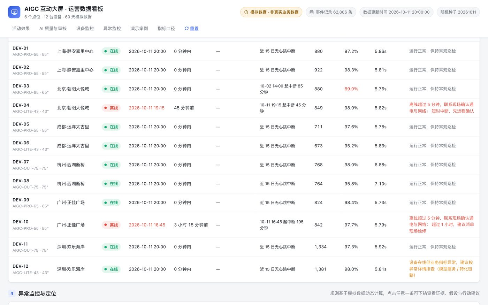
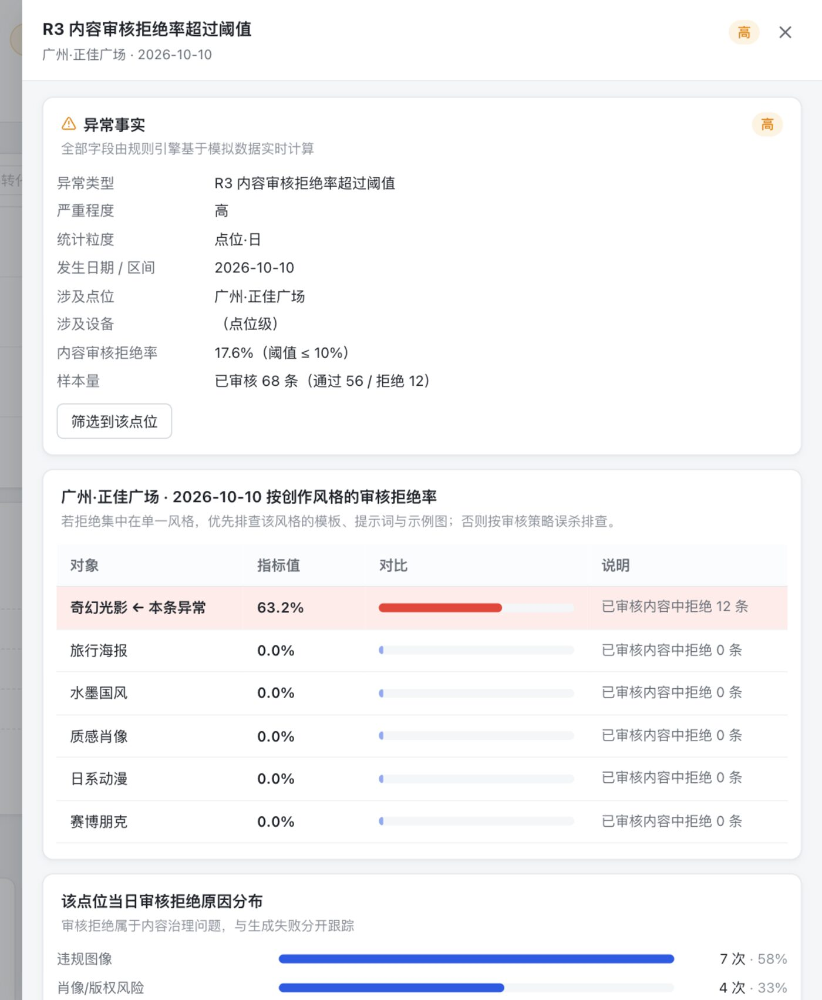
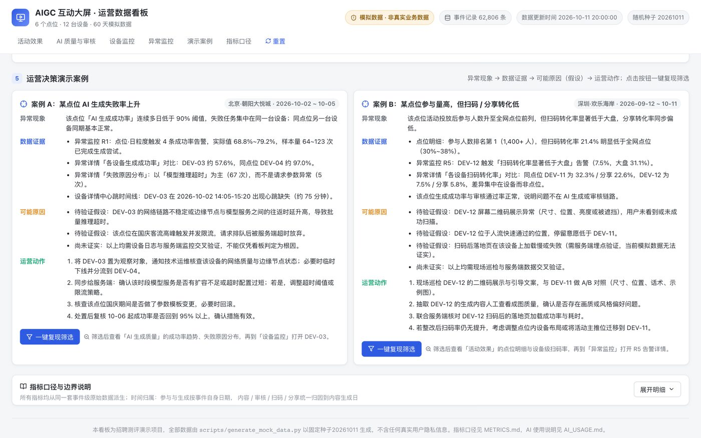

# AIGC 互动大屏 · 运营数据看板

面向 AIGC 互动大屏运营场景的后台数据看板。它把「活动效果、AI 生成质量、内容审核、设备状态」四个视角收在一屏里，并内置一套由规则实时计算的异常监控，帮助运营人员完成：

**监控业务表现 → 发现异常 → 定位问题 → 判断影响 → 采取行动**

全部数据均为模拟数据，不含任何真实用户隐私信息，也不会调用真实大模型服务。

---

## 在线体验

**看板地址（直接打开即可，无需安装、无需登录）：**

### 👉 https://etan330.github.io/aigc-screen-ops-dashboard/

> 源码仓库：https://github.com/Etan330/aigc-screen-ops-dashboard
> 两个地址用途不同：上面是可直接使用的看板，下面是源码。招聘方查看作品请使用第一个。

首次打开需加载约 10MB 事件级模拟数据，约 1–2 秒，期间有加载提示。建议在宽度 ≥1280px 的电脑屏幕上浏览。



---

## 一、业务场景与目标用户

某品牌在全国多个商场、景区部署了多台 AIGC 互动大屏。用户走到屏幕前参与互动（拍照、选风格、AI 生成个性化图片），再通过扫码保存或分享内容。

完整业务链路：

```
用户参与 → 发起 AI 生成 → 生成成功 / 失败 → 内容安全审核 → 结果展示 → 用户扫码 / 分享
```

**目标用户**：品牌方的活动运营、点位运营与技术运维人员。

## 二、这个看板解决什么问题

日常运营里最容易踩的三个坑，看板分别给出了应对：

| 常见的运营盲区 | 看板的应对方式 |
| --- | --- |
| 只看到「参与人数很多」，但不知道内容有没有真正被带走 | 用扫码 / 分享转化率回答「用户愿不愿意保存和分享」，并支持下钻到单台设备 |
| 把「内容没出来」笼统归为一类问题 | 明确拆分为**生成失败（技术链路）**与**审核拒绝（内容治理）**，分母、归因、责任人都不同 |
| 异常只在事后人工翻报表时才发现 | 5 条规则**实时计算**异常，每条附带实际值 / 阈值 / 样本量、待验证假设与排查动作 |

## 三、核心功能

### 1. 全局筛选

日期范围（今日 / 近 7 天 / 近 30 天 / 自定义）+ 点位筛选。切换后 KPI 卡、趋势图、漏斗、点位明细、失败与拒绝原因分布、异常列表全部同步变化，筛选栏底部实时显示「命中事件记录数」。

时间轴、点位范围与数据基准时间始终可见；超出数据范围或起止日期倒置时会给出明确提示，而不是静默出错。

### 2. 核心 KPI 概览

7 张卡片：参与人数、AI 生成成功率、扫码转化率、分享转化率、平均生成时长、内容审核通过率、设备在线率。

每张卡片除了数值，还给出**分子 / 分母**（例如「成功 10,479 / 已完成 10,594 次」）、与**上一等长可比周期**的对比，以及口径提示（例如生成中任务不计入分母、跨点位重复用户已去重）。

### 3. 活动效果分析

每日参与人数趋势、生成成功 / 失败趋势（柱 + 成功率折线）、转化漏斗、各点位效果对比与可排序明细表。

其中漏斗刻意做了**分层**处理：

- 用户层统计「去重人数」（参与用户 → 发起生成的用户）；
- 内容层统计「内容条数」（生成成功 → 审核通过 → 至少扫码一次 → 至少成功分享一次）。

两层的统计对象不同，不做跨层转化率计算，避免把人数、任务次数、内容数混算成一条漏斗。



### 4. AI 生成质量与内容审核

生成成功率趋势（带 90% 阈值线）、平均生成时长与 P95（带 15s 阈值线）、生成失败原因分布、内容审核状态分布、拒绝原因分布，以及按创作风格拆分的审核拒绝率。

风格维度的拒绝率使用「**相对当日大盘的加权平均偏离**」：先扣除「当天整体审核变严」这类日级效应，再按样本量加权，因此长区间被平均后仍能看出拒绝是否集中在某一个风格模板上。



### 5. 设备运行监控

12 台设备的状态列表：设备 ID、所属点位、在线 / 离线、最近心跳时间、近 7 日心跳在线率、最近运行异常、区间业务表现与可执行的运营动作建议。支持按状态筛选，点击任意一行打开详情。

设备详情包含：基本信息、最近 12 小时心跳时间线（红色格子表示运营时段内心跳缺失）、业务表现、心跳中断记录，以及关联的异常条目。



**在线状态是实时口径**：只相对模拟数据的基准时间判定，不随历史日期筛选变化，避免用历史区间误判「现在哪台设备离线」。

### 6. 异常监控与定位

| 规则 | 粒度 | 触发条件（演示阈值，可修改） |
| --- | --- | --- |
| R1 生成成功率 | 点位·日 | < 90% 且当日已完成生成尝试 ≥ 20 次 |
| R2 平均生成时长 | 点位·日 | > 15s 且当日成功任务 ≥ 20 次 |
| R3 审核拒绝率 | 点位·日 | > 10% 且当日已审核内容 ≥ 20 条 |
| R4 设备离线 | 设备·实时 | 最近心跳距基准时间 > 5 分钟 |
| R5 扫码转化异常（扩展） | 设备·区间 | 扫码转化率 < 大盘 50% 且可扫码有效内容 ≥ 30 条 |

异常按规则与严重程度筛选，点击任意一条打开详情抽屉，可以看到：

1. **异常事实**：类型、严重度、粒度、日期、涉及点位 / 设备、实际值 vs 阈值、样本量；
2. **对比证据**：同点位各设备 / 各风格的横向对比；
3. **分布证据**：失败原因、拒绝原因或耗时分桶；
4. **原始样例**：直接取自定义原始数据的具体记录（任务 ID、时间、设备、原因），可逐条回溯；
5. **可能的原因**：全部明确标注为**待验证假设**，不把数据间接支持的判断写成已确认根因；
6. **运营建议与下一步排查方向**。



阈值集中定义在 `src/lib/config.ts`，页面底部会同步展示当前生效的阈值，便于后续调整。样本量下限用于避免小样本误报。

### 7. 运营决策演示案例

内置两个端到端案例，每个都按「异常现象 → 数据证据 → 可能原因（假设）→ 运营动作」展开，并提供「一键复现筛选」按钮，可直接复现异常场景：

- **案例 A**：某点位 AI 生成失败率上升 → 定位到单台设备的模型推理超时与心跳中断 → 排查网络链路与服务端超时配置。
- **案例 B**：某点位参与量高但扫码 / 分享转化低 → 定位到同点位一台设备的扫码率异常 → 现场巡检二维码展示并做 A/B 对照。



## 四、指标口径

7 项核心指标的定义、分子分母、去重规则、运营意义与对应的运营动作，见 **[METRICS.md](METRICS.md)**（同时提供一页版 `METRICS.pdf`）。

所有指标都从同一套事件级原始数据派生，任何图表、卡片、详情页都不写死结果，因此不会出现「同一指标在不同页面数值不一致」的情况。

## 五、模拟数据

### 来源

由项目内脚本 `scripts/generate_mock_data.py` 生成，**固定随机种子 `20261011`**，多次运行结果完全一致，可复现。生成过程中人工注入了 5 类异常场景，因此在原始数据里都能找到对应证据。

### 结构

| 文件 | 内容 | 规模 |
| --- | --- | --- |
| `public/data/mock_sites.json` | 点位维度表 | 6 个点位（商场 / 景区） |
| `public/data/mock_devices.json` | 设备维度表 | 12 台设备 |
| `public/data/mock_events.json` | 事件事实表 | 约 6.3 万条：参与、生成任务、内容、审核、扫码、分享 |
| `public/data/mock_heartbeats.json` | 设备心跳 | 26,828 条，5 分钟粒度，保留 15 天 |
| `public/data/mock_meta.json` | 元信息 | 基准时间、种子、字典、注入的异常场景与口径说明 |

数据关联链路（所有 ID 在原始数据中可逐条回溯）：

```
点位 siteId → 设备 deviceId → 匿名用户 userId → 参与事件 eventId
            → 生成任务 taskId → 内容 contentId → 审核结果 → 扫码 / 分享事件
```

### 复现

```bash
python3 scripts/generate_mock_data.py
```

### 注入的 5 类异常（均可在线验证）

| 场景 | 位置 | 时间窗 | 原始数据中的证据 |
| --- | --- | --- | --- |
| 生成失败率上升 | SITE-02 / DEV-03 | 10-02 ~ 10-05 | DEV-03 失败率 42.4%，原因以「模型推理超时」为主；同点位 DEV-04 成功率 97.0%；DEV-03 心跳 14:05–15:20 中断 |
| 平均生成时长变慢 | SITE-04（两台户外机） | 10-06 ~ 10-08 | 日均耗时 17.5s / 18.6s / 17.6s，基线约 5.6s |
| 审核拒绝率上升 | SITE-05 | 10-07 ~ 10-10 | 点位拒绝率 12.2%–17.6%；「奇幻光影」风格 60.4%，其余风格 0%–4.8% |
| 设备离线 | DEV-04 / DEV-10 | 基准时点 | 心跳数组在对应时点后无记录（45 分钟 / 3 小时 15 分钟） |
| 高参与低转化 | SITE-06 / DEV-12 | 09-12 ~ 10-11 | DEV-12 扫码率 7.5%，同点位 DEV-11 为 32.3%（大盘 31.1%） |

**统计截止时间**：模拟数据基准时间为 `2026-10-11 20:00:00`（Asia/Shanghai）。所有设备在线判断都相对这一基准时间计算，它不是真实当前时间。

## 六、本地运行

适合需要在本地查看源码或二次开发的场景；只想看作品的话直接打开上面的在线地址即可。

```bash
# 1. 确认环境：Node.js ≥ 18、Python 3 ≥ 3.9
node -v
python3 -V

# 2. 安装依赖
npm install

# 3. 启动开发服务器
npm run dev
# 浏览器打开 http://localhost:5173

# 其他命令
npm run build      # 类型检查 + 生产构建，产物在 dist/
npm run preview    # 本地预览生产构建
npm test           # 运行 24 项自动化测试
npm run typecheck  # 仅类型检查
```

## 七、项目结构

```
.
├── README.md / METRICS.md / AI_USAGE.md   作品说明、指标口径、AI 工具使用说明
├── docs/screenshots/                      README 展示用截图
├── .github/workflows/deploy.yml           GitHub Actions：自动构建并部署到 GitHub Pages
├── scripts/generate_mock_data.py          模拟数据生成脚本（固定种子）
├── public/data/                           模拟数据（前端运行时读取）
└── src/
    ├── types.ts                           数据模型与 ID 关联关系
    ├── lib/
    │   ├── config.ts                      异常阈值与展示配置（改这里全站生效）
    │   ├── metrics.ts                     指标计算：全部从事件级数据派生
    │   ├── anomalies.ts                   异常规则引擎与证据下钻
    │   ├── time.ts / data.ts / format.ts  时间、数据加载与格式化工具
    │   └── *.test.ts                      24 项自动化测试
    ├── components/                        筛选栏、KPI、四个业务区、案例、抽屉等 12 个组件
    ├── App.tsx / main.tsx                 应用入口与状态编排
    └── styles.css                         统一视觉样式
```

## 八、技术栈

React 18 · Vite 5 · TypeScript（strict）· Recharts · lucide-react · Vitest
纯 CSS 设计系统，本地 JSON 模拟数据，无数据库、无登录、无真实 AI API、无持续运行的后端服务。

## 九、注意事项与已知限制

1. **全部为模拟数据**，不代表任何真实业务的经营情况，也不含真实用户隐私信息。
2. 模拟数据基准时间固定为 `2026-10-11 20:00:00`（Asia/Shanghai），不是真实当前时间。
3. 默认「近 30 天 + 全部点位」会显示 15 条异常，其中 1 条是阈值附近的基线噪声（成功率 86.5%，严重度仅为「高」）。这是真实数据的常态，需要结合样本量与趋势判断，而不是看到红点就报警。
4. 事件文件约 10MB、纯前端聚合，加载与筛选在本机范围内是够用的；真实生产环境应改为服务端预聚合接口。
5. 设备心跳只保留最近 15 天，更早的历史在线率无法计算。
6. 扫码后落地页的加载成功率没有模拟数据支撑，案例 B 中相关判断已标注为「需服务端埋点验证」。
7. 仅在本机 Google Chrome 上做过完整验证，未覆盖 Safari / Firefox，也未做移动端适配（布局最小适配到 900px 宽度）。

---

## 附：建议的浏览路径（约 3 分钟）

1. 打开在线地址，看顶部 7 张 KPI 卡与「活动效果分析」的趋势图；
2. 滚到「异常监控与定位」，点击 **R1 生成成功率** 过滤，任选一条打开详情，核对「各设备对比 → 失败原因分布 → 失败任务原始样例」三级证据；
3. 再把点位切到 **北京·朝阳大悦城**，点开 **DEV-03** 的设备详情，看 10-02 下午的红色心跳缺失段；
4. 最后滚到「运营决策演示案例」，点「一键复现筛选」体验两个完整案例。
